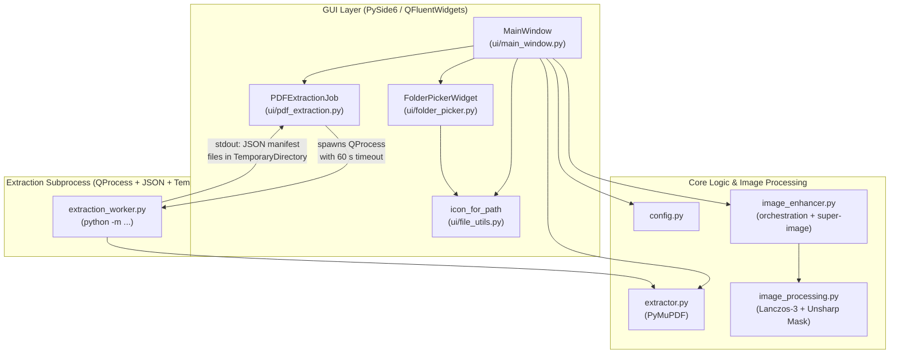
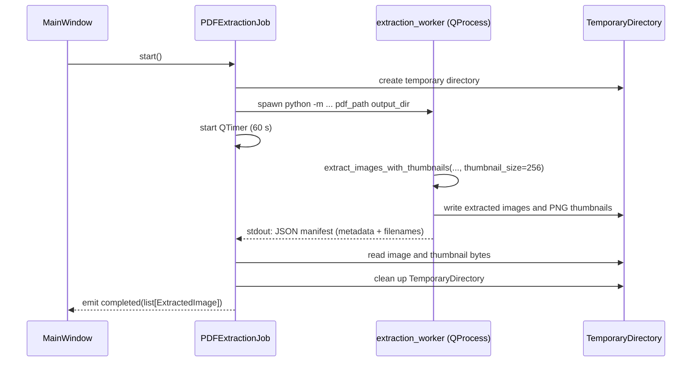

# System Architecture

**PDF Asset Extractor** follows a layered architecture that separates the desktop GUI, an isolated
PDF-reading subprocess, core extraction/orchestration logic, and low-level NumPy image-processing
primitives.

## Layer Overview

### Separation of Responsibilities

1. **Presentation layer (`src/pdf_asset_extractor/ui/`)**
   - Manages the main window, navigation across three views (folder picker, PDF tile grid, image
     preview & export), enhancement controls, and error dialogs.
   - Never parses PDF files on the Qt main thread — extraction is always delegated to
     `PDFExtractionJob`.
2. **Process isolation layer (`extraction_worker.py` + `ui/pdf_extraction.py`)**
   - Protects the GUI from freezing or crashing on malformed or oversized PDF files.
   - Each PDF read runs in a dedicated Python subprocess guarded by a hard timeout (`60 s`) and
     can be cancelled immediately if the user selects another PDF.
3. **Extraction and encoding layer (`extractor.py`)**
   - Wraps PyMuPDF (`fitz`) for opening PDFs, authenticating encrypted documents, iterating over
     pages and embedded images, generating PNG thumbnails, and encoding exports (`original`,
     `png`, `jpg`).
4. **Image enhancement layer (`image_enhancer.py` + `image_processing.py`)**
   - `image_enhancer.py` provides a single facade over all enhancement backends (`none`,
     `lanczos`, `unsharp-mask`, `super-image`), handles CPU thread-pool / GPU batch execution, and
     caches the active neural upscaling model.
   - `image_processing.py` implements Lanczos-3 resampling and Gaussian unsharp masking from
     scratch in NumPy, with no calls to `PIL.Image.resize` or `PIL.ImageFilter`.

## Inter-Process Communication (IPC) for PDF Reading

PDF extraction uses a lightweight file-and-manifest protocol so large binary image payloads are
not Base64-encoded into JSON over stdout:

- When the user clicks a different PDF before the active job finishes, `MainWindow` calls
  `cancel()` on the previous `PDFExtractionJob` (killing the subprocess) and ignores stale signals
  via the identity guard `self._extraction_job is not job`.
- If `timeout_seconds` (default `60 s`) elapses, `QTimer` kills the subprocess and emits `failed`
  with a timeout error message.

## Concurrency and Performance Model

- **GUI / PDF extraction**: asynchronous `QProcess` integrated with the Qt event loop.
- **CPU enhancement batches (`enhance_images`)**: setting `workers > 1` dispatches items across a
  `ThreadPoolExecutor`. Vectorized NumPy array operations release the GIL, allowing parallel CPU
  throughput.
- **Neural super-resolution (`super-image`)**:
  - Images sharing the same dimensions can be concatenated into one PyTorch batch tensor
    (`torch.cat(..., dim=0)`) and evaluated inside `torch.inference_mode()`.
  - The most recently used pretrained model is cached via `@lru_cache(maxsize=1)` in
    `_load_super_image_model`, avoiding repeated weight loading across images.
  - Device selection (`_resolve_device`): `"auto"` selects `"cuda"` when available and falls back
    safely to `"cpu"`.

## Error Handling

Domain exceptions inherit from `RuntimeError` and translate low-level library failures into
user-facing messages (currently localized in Polish for the GUI `MessageBox` dialogs):

- `PDFExtractionError` (`extractor.py`) — unreadable/corrupted PDF, missing password, or failure
  extracting a specific embedded image.
- `ImageConversionError` (`extractor.py`) — failure encoding an image to `PNG` or `JPEG`.
- `EnhancementError` (`image_enhancer.py`) — invalid enhancement options, missing `super-image`
  dependency, unavailable CUDA when `device="cuda"` is explicitly requested, or decode failure.
  - `EnhancementOutOfMemoryError(EnhancementError)` — GPU VRAM exhaustion during `super-image`
    inference (kept distinct so callers such as the benchmark can re-raise it immediately).
